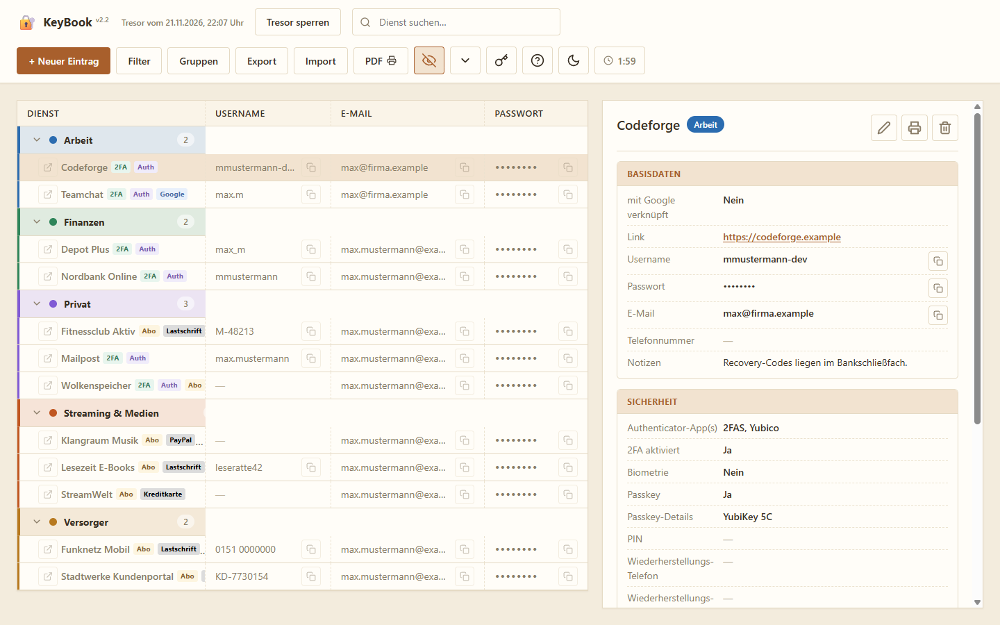
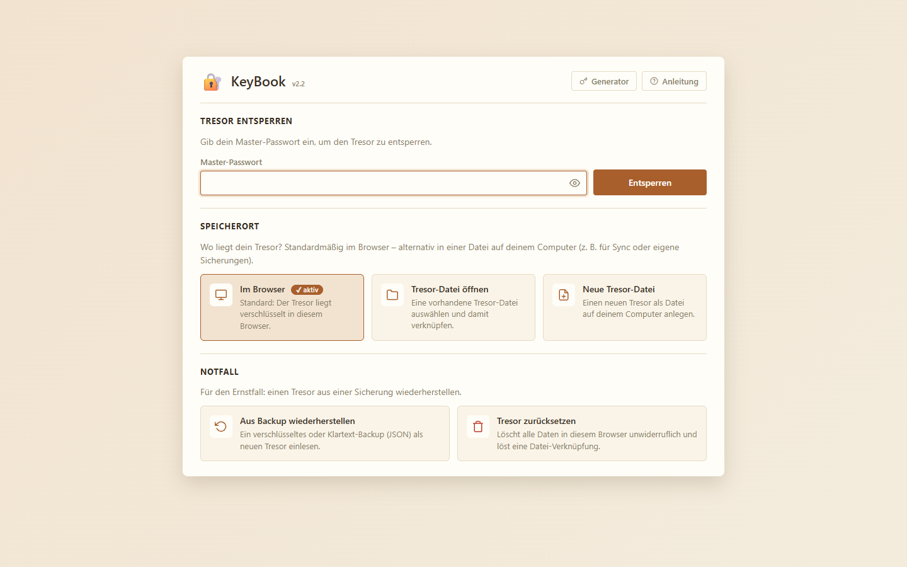
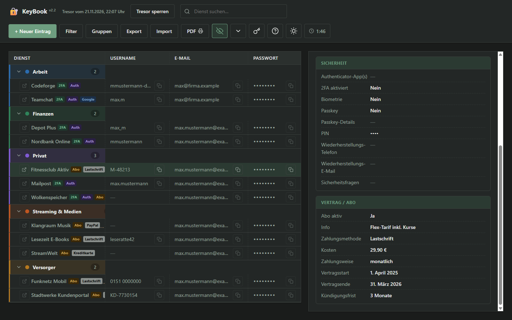
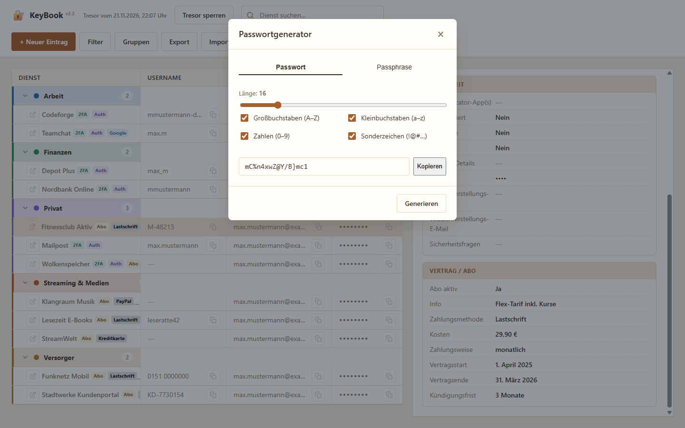

# KeyBook

**Clientseitiger Passwort-Manager, der komplett offline im Browser läuft.**
Kein Server, keine Cloud, keine Abhängigkeiten: nur HTML, CSS und Vanilla JavaScript.
Zum Starten öffnest du einfach `index.html` per Doppelklick.



> ⚠️ **Hinweis:** KeyBook ist ein privates Projekt und wurde **keinem unabhängigen
> Sicherheits-Audit** unterzogen. Nutzung auf eigenes Risiko. Ein vergessenes
> Master-Passwort lässt sich **nicht** wiederherstellen. Lege regelmäßig Backups an.

---

## Funktionen

- **Verschlüsselter Tresor:** AES-GCM-256, Schlüssel per PBKDF2-HMAC-SHA256 mit 600.000 Iterationen
- **Ausführliche Einträge:** Login-Daten, 2FA und Authenticator-Apps, Passkey, PIN, Wiederherstellungsdaten,
  Sicherheitsfragen sowie Vertrags- und Abo-Daten (Kosten, Laufzeit, Kündigungsfrist)
- **Gruppen** mit Farben, **Suche** und kombinierbare **Filter** (Gruppe, Abo, 2FA)
- **Passwort- und Passphrasen-Generator** auf Basis von `crypto.getRandomValues`
- **Zwischenablage mit Auto-Löschung** nach 30 Sekunden
- **Auto-Sperre** nach 2 Minuten Inaktivität, mit Countdown im Header
- **Backup und Wiederherstellung:** Export verschlüsselt (empfohlen) oder als Klartext, Import mit Ersetzen oder Zusammenführen
- **Tresor-Datei** (optional, nur Chromium): Der Tresor wird statt im Browser-Speicher in einer Datei deiner Wahl gespeichert
- **Drucken / PDF:** tabellarisch, nach Gruppen sortiert
- **Hell- und Dunkelmodus**
- **Eingebaute Kurzanleitung** (❓ im Header)

## Ansichten

| Sperrbildschirm | Dunkelmodus | Passwort-Generator |
| :-: | :-: | :-: |
|  |  |  |

*Alle Daten in den Screenshots sind frei erfunden.*

## Starten

**Empfohlen: aus den [Releases](../../releases)**

1. Die Datei `KeyBook-x.y.zip` des neuesten Release herunterladen und entpacken.
2. Im entpackten Ordner `index.html` öffnen (Doppelklick).
3. Beim ersten Start ein Master-Passwort festlegen. Fertig.

**Alternativ aus dem Repository** (per `git clone` oder **Code → Download ZIP**):
Hier liegt die App im Unterordner `app/`. Zum Starten also `app/index.html` öffnen.

Es gibt keinen Build-Schritt und keine Installation, und die App braucht keine Internetverbindung.

### Browser-Unterstützung

| Funktion | Chrome / Edge | Firefox | Safari |
| --- | :-: | :-: | :-: |
| Tresor im Browser-Speicher | ✅ | ✅ | ✅ |
| Tresor-Datei (File System Access API) | ✅ | ❌ | ❌ |

In Firefox und Safari lässt sich eine Tresor-Datei trotzdem über **Import** bzw.
**Aus Backup wiederherstellen** einlesen.

> **Wichtig:** Ohne verknüpfte Tresor-Datei liegt der Tresor im `localStorage` des jeweiligen
> Browsers. Wenn du die Browserdaten löschst oder den Browser wechselst, ist er dort weg.
> Exportiere deshalb regelmäßig ein verschlüsseltes Backup.

## Sicherheitsmodell

| Aspekt | Umsetzung |
| --- | --- |
| Verschlüsselung | AES-GCM-256 (Web Crypto API). Manipulationen fallen über den Auth-Tag auf. |
| Schlüsselableitung | PBKDF2-HMAC-SHA256, 600.000 Iterationen, zufälliger Salt pro Tresor |
| Speicherung | Nur verschlüsselt: im `localStorage` oder in der verknüpften Tresor-Datei |
| Laufzeit | Der Schlüssel liegt nur im Arbeitsspeicher. Beim Sperren werden Schlüssel, Klartext im DOM und Zwischenablage geleert. |
| Netzwerk | Keine Verbindungen. Die CSP setzt `connect-src 'none'`. Keine externen Skripte, Fonts oder CDNs. |
| Wiederherstellung | Keine. Ohne Master-Passwort kommt niemand an die Daten, auch du nicht. |

Ältere Tresore mit weniger PBKDF2-Iterationen werden beim Entsperren automatisch
auf den aktuellen Wert hochgestuft.

Sicherheitslücken bitte **nicht** als öffentliches Issue melden, sondern wie in [SECURITY.md](SECURITY.md) beschrieben.

## Projektstruktur

```text
app/
├── index.html      Markup, Dialoge, Druckbereich
├── styles.css      Styles, Theme-Variablen, Druck-Layout
├── app.js          Gesamte Anwendungslogik
└── anleitung.html  Benutzer-Kurzanleitung
```

## Lizenz

[MIT](LICENSE)
